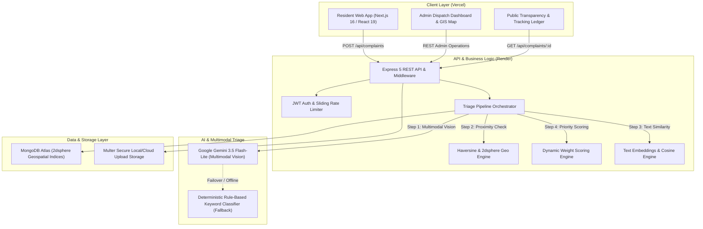
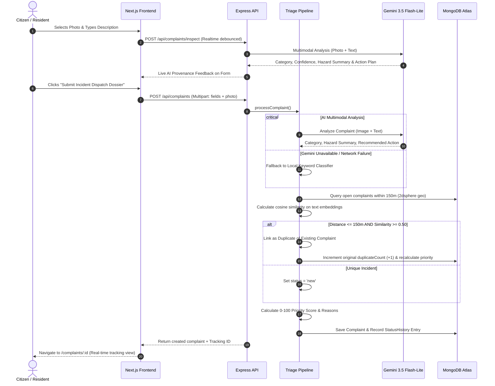

# Smart Civic Complaint Triage System (CivicPulse / SC-01)
## Complete System Architecture, Data Models, Workflows & Technical Documentation

---

## 1. Executive Summary & Problem Statement

### 1.1 The Challenge (OpenHack'26 • Problem SC-01)
Municipalities and public works departments receive thousands of citizen complaints weekly across fragmented channels (phone hotlines, social media, walk-ins). This leads to:
1. **Unstructured & Duplicate Data:** Multiple citizens report the same pothole or water leak, overwhelming dispatchers.
2. **Opaque Prioritization:** "First-come, first-served" triage often leaves hazardous emergencies (e.g. broken water mains near hospitals, open sinkholes near schools) unaddressed while minor issues are processed first.
3. **The "Black Hole" Resident Experience:** Citizens receive no transparent progress updates, lose trust in government responsiveness, and submit duplicate complaints out of frustration.

### 1.2 The Solution
**CivicPulse (SC-01)** is an autonomous, explainable civic triage platform that:
- **Enables Rapid Reporting:** Citizens file geotagged complaints with photo evidence in under 60 seconds on any device (anonymous or authenticated).
- **Performs Multimodal AI Inspection:** Real-time multimodal computer vision (**Google Gemini 3.5 Flash-Lite**) classifies defects, assesses hazards, and drafts dispatch action plans.
- **Deduplicates Spatially & Semantically:** MongoDB geospatial 2dsphere indexing and vector cosine similarity automatically link cluster reports and dynamically escalate priority.
- **Calculates Explainable Priority (0–100):** Every score is calculated via transparent, administrator-calibrated municipal rules (severity, duplicates, sensitive infrastructure proximity, age, photo verification).
- **Enforces Evidence-Backed Resolution:** Staff must provide verifiable "after" resolution photo evidence and notes before closing tickets, complete with a 72-hour citizen reopen window.

---

## 2. High-Level System Architecture



### Technical Stack Summary
- **Frontend:** Next.js 16 (App Router, Turbopack), React 19, TypeScript, Tailwind CSS v4, Lucide Icons, Leaflet / OpenStreetMap. Hosted on **Vercel**.
- **Backend:** Node.js 20+, Express 5, Mongoose 9, Multer, JWT, Morgan, CORS, Bcryptjs. Hosted on **Render**.
- **Database:** MongoDB (with geospatial `2dsphere` indexes for proximity queries).
- **AI & Vision:** Google GenAI SDK (`@google/genai`) targeting `gemini-3.5-flash-lite`, with multi-model failover and zero-downtime local keyword classification fallback.

---

## 3. Core Database Models & Schemas

### 3.1 `Complaint` Model (`backend/src/models/Complaint.js`)
The primary document representing a reported municipal incident.

| Field | Type | Description / Constraints |
| :--- | :--- | :--- |
| `title` | `String` | Brief incident title (auto-generated by AI or entered by user). |
| `description` | `String` | **Required.** Detailed description of the defect or hazard. |
| `category` | `String` | Enum: `road_damage`, `garbage`, `streetlight`, `water_leakage`, `blocked_drain`, `other`. |
| `aiCategory` | `String` | Category determined autonomously by the AI triage engine. |
| `aiConfidence` | `Number` | Confidence score between `0.0` and `1.0` (e.g. `0.96`). |
| `aiSource` | `String` | Enum: `'gemini'` (LLM multimodal vision) or `'rules'` (local classifier). |
| `aiReason` | `String` | Machine-readable visual hazard assessment summary. |
| `recommendedAction` | `String` | Actionable dispatch recommendation (e.g. "Cold patch crew required"). |
| `modelUsed` | `String` | Actual model ID used (e.g. `'gemini-3.5-flash-lite'`). |
| `photoUrl` | `String` | Path or URL to original incident evidence photo. |
| `location.lat` | `Number` | **Required.** Latitude (-90 to 90). |
| `location.lng` | `Number` | **Required.** Longitude (-180 to 180). |
| `location.address` | `String` | Reverse-geocoded or user-supplied address. |
| `location.geo` | `GeoJSON Point` | `[lng, lat]` coordinates indexed via **2dsphere**. |
| `embedding` | `[Number]` | High-dimensional text embedding vector (hidden from public queries). |
| `status` | `String` | Enum: `new`, `under_review`, `assigned`, `in_progress`, `resolved`, `closed`, `duplicate`, `rejected`. |
| `priorityScore` | `Number` | Calculated score from `0` to `100`. |
| `priorityBand` | `String` | Enum: `'low'` (<40), `'medium'` (40-69), `'high'` (≥70). |
| `priorityReasons` | `[String]` | Explainability array: `["Road damage severity (+30)", "Within 150m of school (+20)"]`. |
| `duplicateOf` | `ObjectId` | Reference to original `Complaint` document if linked as a duplicate. |
| `duplicateCount` | `Number` | Count of duplicate reports confirmed or linked to this primary issue. |
| `department` | `String` | Assigned municipal department (e.g. `Dept of Public Works & Roads`). |
| `resident` | `ObjectId` | Optional reference to authenticated `User`. |
| `residentContact` | `Object` | Contact details: `{ name, email, phone }`. |
| `resolvedEvidencePhotoUrl` | `String` | Proof photo required to mark ticket resolved. |

---

### 3.2 `User` Model (`backend/src/models/User.js`)
Handles authentication, identity, and role-based access control.

| Field | Type | Description |
| :--- | :--- | :--- |
| `name` | `String` | Submitter or administrator display name. |
| `email` | `String` | Unique indexed email address (normalized to lowercase). |
| `passwordHash` | `String` | Bcrypt salt-hashed password (hidden from queries). |
| `role` | `String` | Enum: `'resident'` (default) or `'admin'`. |

---

### 3.3 `RuleSettings` Model (`backend/src/models/RuleSettings.js`)
Configurable weights and thresholds for the transparent priority engine. Editable by administrators in real-time.

| Field Group | Field | Default Value | Description |
| :--- | :--- | :--- | :--- |
| **Category Weights** | `road_damage` | `30` | Base severity points for potholes/asphalt. |
| | `water_leakage` | `30` | Base severity points for main bursts/flooding. |
| | `blocked_drain` | `25` | Base points for sewage/stormwater backup. |
| | `garbage` | `20` | Base points for illegal dumping/overflowing bins. |
| | `streetlight` | `15` | Base points for grid outages/dark streets. |
| | `other` | `10` | Base points for general municipal queries. |
| **Weights & Limits** | `maxCategoryWeight` | `35` | Maximum ceiling for category contribution. |
| | `duplicateWeight` | `25` | Maximum ceiling for duplicate report bonuses. |
| | `pointsPerDuplicate`| `5` | Points added per duplicate report received. |
| | `sensitiveZoneWeight`| `20` | Boost for proximity to schools, hospitals, or highways. |
| | `photoEvidenceWeight`| `5` | Points for verified photographic evidence. |
| | `ageWeight` | `15` | Maximum ceiling for aging tickets. |
| | `pointsPerDayAge` | `2` | Points accrued per 24 hours of ticket age. |
| **Thresholds** | `highPriority` | `70` | Threshold for High priority band (`>= 70`). |
| | `mediumPriority` | `40` | Threshold for Medium priority band (`40-69`). |
| | `duplicateRadiusMeters` | `150` | Maximum radius in meters for duplicate clustering. |
| | `duplicateSimilarityThreshold` | `0.50` | Minimum vector similarity required to link duplicate. |

---

### 3.4 `SensitiveZone` Model (`backend/src/models/SensitiveZone.js`)
Geofenced municipal landmarks that receive elevated priority when defects occur nearby.

- **Types:** `school`, `hospital`, `main road`, `government`, `transit`.
- **Fields:** `name`, `type`, `lat`, `lng`, `radius` (in meters), `active`.

---

### 3.5 `StatusHistory` Model (`backend/src/models/StatusHistory.js`)
Immutable audit log tracking every transition from submission to final resolution.

- **Fields:** `complaintId`, `status`, `note`, `evidencePhotoUrl`, `changedBy` (`{ userId, name, role }`), `changedAt`.

---

## 4. End-to-End Processing Workflows

### 4.1 Citizen Complaint Submission & Triage Workflow



---

### 4.2 Priority Scoring Mathematics
The composite priority score $S \in [0, 100]$ is computed deterministically via:

$$S = \min\left(100, W_{\text{cat}} + W_{\text{dup}} + W_{\text{zone}} + W_{\text{photo}} + W_{\text{age}}\right)$$

Where:
1. **$W_{\text{cat}}$ (Category Severity):** Looked up from active `RuleSettings` (e.g. `road_damage` = 30 pts, `garbage` = 20 pts). Capped at `maxCategoryWeight` (35 pts).
2. **$W_{\text{dup}}$ (Duplicate Report Density):**
   $$W_{\text{dup}} = \min\left(25, \text{duplicateCount} \times 5\right)$$
3. **$W_{\text{zone}}$ (Sensitive Zone Proximity):**
   If the defect falls within the radius of an active sensitive zone (school, hospital, arterial highway), adds $+20$ points.
4. **$W_{\text{photo}}$ (Photographic Evidence):**
   If photographic evidence is attached, adds $+5$ points for verified field validity.
5. **$W_{\text{age}}$ (SLA Age Escalation):**
   $$W_{\text{age}} = \min\left(15, \lfloor\text{age in days}\rfloor \times 2\right)$$

**Priority Bands:**
- **High Band (Red):** $S \ge 70$
- **Medium Band (Amber):** $40 \le S < 70$
- **Low Band (Blue/Gray):** $S < 40$

---

### 4.3 Duplicate Detection Algorithm
To prevent duplicate work orders, every complaint executes spatial-semantic clustering:
1. **Geospatial Filtering:** MongoDB `$nearSphere` or Haversine distance search queries candidate open complaints within `DUP_RADIUS_METERS` (default: **150 meters**).
2. **Category Matching:** Candidates must share the same operational category (e.g. a pothole does not cluster with a nearby streetlight outage).
3. **Semantic Text Similarity:** Calculates cosine similarity between normalized 300-dimension term frequency vectors:
   $$\text{Similarity}(A, B) = \frac{\mathbf{A} \cdot \mathbf{B}}{\|\mathbf{A}\| \|\mathbf{B}\|}$$
4. **Threshold Evaluation:** If similarity $\ge 0.50$ (configurable via `DUP_SIM_THRESHOLD`), the new report is marked `status: 'duplicate'`, linked via `duplicateOf: original._id`, and the primary ticket's score automatically scales up.

---

### 4.4 Resolution & Closed-Loop Verification Workflow
1. **Assignment:** Municipal dispatcher assigns ticket to a field division (e.g. `Water & Utilities Board · Roadway Division · Truck 14`).
2. **Work in Progress:** Field crew updates status to `in_progress`.
3. **Evidence-Based Closure:** To set status to `resolved`, administrative staff **must upload an "after" resolution photo** and enter closure notes into the audit history.
4. **Resident Audit & 72-Hour Reopen Window:** The resident tracking portal shows before-and-after photographic proof. If the issue was improperly resolved, the resident has a 72-hour window to reopen the complaint with a single click.

---

## 5. Complete REST API Specifications

All endpoints communicate via JSON over HTTPS. Root path: `/api`.

### 5.1 Public Endpoints

| Method | Endpoint | Description |
| :--- | :--- | :--- |
| `GET` | `/api/health` | System health check (database connection status, Gemini configuration, candidate models). |
| `POST`| `/api/complaints` | Submit new complaint (`multipart/form-data`: `title`, `description`, `lat`, `lng`, `address`, `category?`, `photo?`). |
| `POST`| `/api/complaints/inspect` | Real-time AI preview without saving (`title`, `description`, `photo?`). |
| `POST`| `/api/complaints/analyze` | Multimodal photo pre-scanner to auto-fill title, description, and category. |
| `GET` | `/api/complaints` | Paginated query of public complaints (`category`, `status`, `page`, `limit`). |
| `GET` | `/api/complaints/:id` | Fetch complaint dossier, duplicate data, and full status timeline history. |
| `GET` | `/api/complaints/nearby`| Spatial query: find complaints within radius of given `lat`, `lng`. |
| `GET` | `/api/complaints/bounds`| Viewport bounding box query for interactive maps (`minLat`, `minLng`, `maxLat`, `maxLng`). |
| `GET` | `/api/complaints/transparency`| Public transparency metrics (resolution rate, avg resolution hours, category aggregates). |

### 5.2 Authentication Endpoints

| Method | Endpoint | Description |
| :--- | :--- | :--- |
| `POST` | `/api/auth/register` | Register resident account (`name`, `email`, `password`). Returns JWT. |
| `POST` | `/api/auth/login` | Authenticate resident or admin (`email`, `password`). Returns JWT + user object. |
| `GET` | `/api/auth/me` | Fetch authenticated profile from bearer token. |
| `PUT` | `/api/auth/password` | Update account password. |

### 5.3 Administrative Endpoints (Requires `Authorization: Bearer <Admin_JWT>`)

| Method | Endpoint | Description |
| :--- | :--- | :--- |
| `GET` | `/api/admin/dashboard` | Administrative overview cards (high priority count, SLA metrics, open queues). |
| `PATCH`| `/api/admin/complaints/:id/status` | Update complaint status with resolution `evidence` photo, `department`, and `note`. |
| `POST` | `/api/admin/complaints/:id/merge` | Manually merge or un-merge a duplicate complaint. |
| `GET` | `/api/admin/rules` | Fetch active prioritization weights and thresholds. |
| `PUT` | `/api/admin/rules` | Update prioritization weights (automatically re-scores open tickets). |
| `GET` | `/api/admin/sensitive-zones`| List all registered sensitive infrastructure zones. |
| `POST` | `/api/admin/sensitive-zones`| Add new sensitive zone (`name`, `type`, `lat`, `lng`, `radius`). |

---

## 6. AI Engine & Zero-Downtime Fallback Architecture

### 6.1 Primary LLM: Google Gemini 3.5 Flash-Lite
The platform uses Google's latest multimodal API via `@google/genai`:
- **Model:** `gemini-3.5-flash-lite` (with automatic failover to `gemini-3.5-flash`, `gemini-3.6-flash`, `gemini-3.8-flash`).
- **Structured JSON Mode:** Enforces `responseMimeType: 'application/json'` to guarantee deterministic machine parsing without prompt hallucinations.
- **Enforced Timeouts:** API calls are wrapped in a 12-second timeout promise race.

### 6.2 Resilient Failover Hierarchy
To guarantee municipal continuity during internet outages, API rate limits (HTTP 429), or cloud provider spikes (HTTP 503):

```
Incoming Complaint Payload
       │
       ▼
[ Valid GEMINI_API_KEY? ] ──No──► [ Deterministic Keyword Classifier ] (aiSource: 'rules')
       │ Yes
       ▼
[ Candidate Models Loop ] ──All Fail / Timeout──► [ Deterministic Keyword Classifier ] (aiSource: 'rules')
  1. gemini-3.5-flash-lite
  2. gemini-3.5-flash
  3. gemini-3.8-flash
       │ Success
       ▼
Multimodal Vision Classification (aiSource: 'gemini')
```

---

## 7. Security & Hardening Safeguards

1. **Strict Input Sanitization & API Key Redaction:**
   All system logs pass through regex filters that scrub Google API keys (`AIzaSy...`, `key=...`) to prevent credential leakage in error handlers or CI pipelines.
2. **Brute-Force Rate Limiting:**
   Sliding-window rate limiter prevents credential stuffing and endpoint spam.
3. **Role Escalation Prevention:**
   Public registration endpoints strictly reject any `role: 'admin'` payload; administrative roles can only be granted via database seeding or direct administrative delegation.
4. **Secure File Upload Pipeline:**
   Multer restricts uploads to `image/jpeg`, `image/png`, and `image/webp` with a strict **5 MB limit**. File names are cryptographically hashed to prevent directory traversal exploits.
5. **CORS Governance:**
   Restricted to allowed production origins (e.g. Vercel deployment domains and localhost for development).

---

## 8. Deployment & Environment Setup

### 8.1 Backend Environment Variables (`backend/.env`)
```env
PORT=5000
NODE_ENV=production
MONGO_URI=mongodb+srv://<user>:<password>@cluster.mongodb.net/civic_complaints_db?retryWrites=true&w=majority
JWT_SECRET=your_super_secret_jwt_key_min_32_characters
CLIENT_URL=https://your-frontend.vercel.app,http://localhost:3000
GEMINI_API_KEY=AIzaSyYourGeminiApiKeyHere
GEMINI_MODEL=gemini-3.5-flash-lite
DUP_RADIUS_METERS=150
DUP_SIM_THRESHOLD=0.50
```

### 8.2 Frontend Environment Variables (`frontend/.env.local` or Vercel Settings)
```env
NEXT_PUBLIC_API_URL=https://civic-triage.onrender.com
```
*(Note: If `NEXT_PUBLIC_API_URL` is omitted, the frontend automatically detects non-localhost hostnames and routes to `https://civic-triage.onrender.com` as a built-in fallback).*

---

## 9. Developer & Partner Quick-Start Guide

### 9.1 Running Locally

**1. Clone the repository:**
```bash
git clone https://github.com/Muhammadumad/civic-triage.git
cd civic-triage
```

**2. Setup & start backend:**
```bash
cd backend
npm install
npm run test:logic   # Runs all 20 business logic unit tests
npm run dev          # Starts Express server on http://localhost:5000
```

**3. Setup & start frontend:**
```bash
cd ../frontend
npm install
npm run dev          # Starts Next.js app on http://localhost:3000
```

**4. Demo Logins:**
- **Admin:** `admin@demo.com` / `admin123`
- **Resident:** `resident@demo.com` / `resident123`
