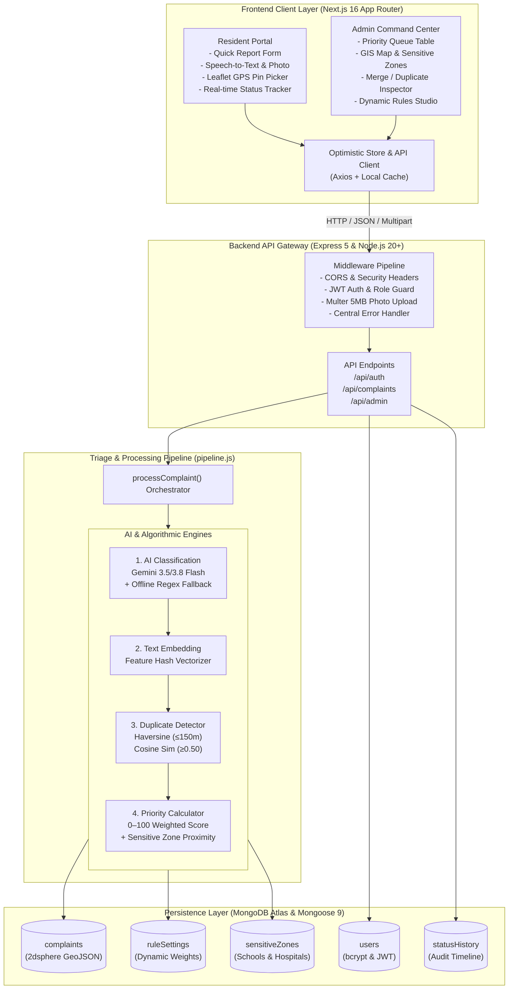
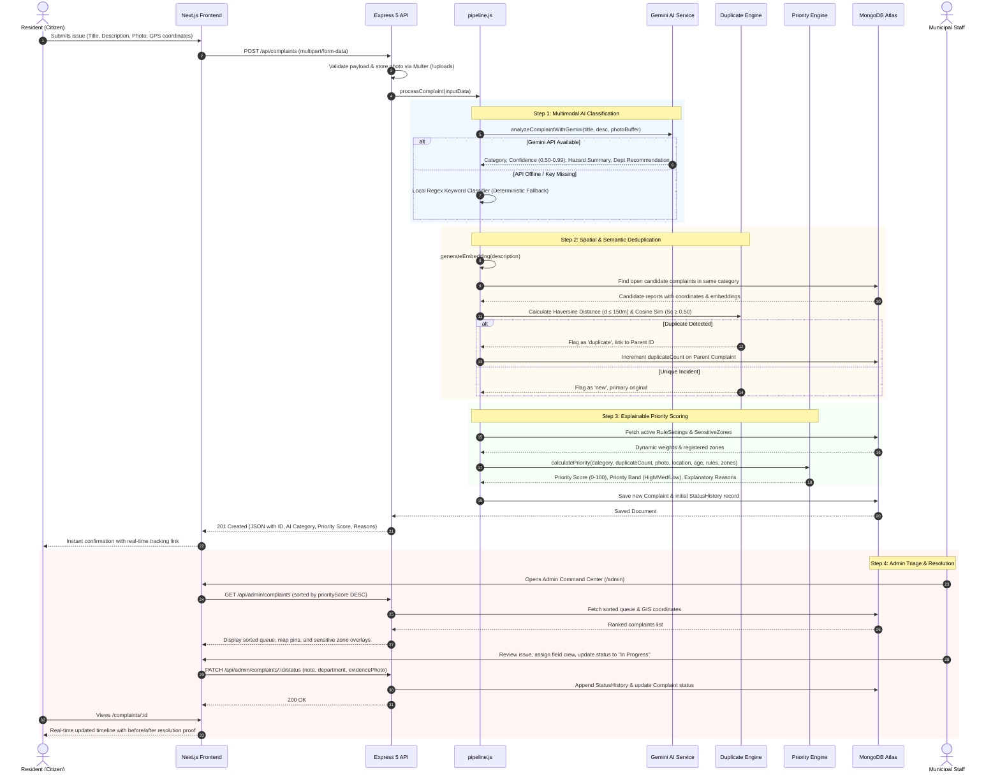

# 🏛️ Smart Civic Complaint Triage System (SC-01)

> **OpenHack'26 Hackathon Project** — Problem Statement **SC-01 (Smart Communities & Public Services)**  
> **One-Line Pitch:** Residents report civic issues in under 60 seconds; the system auto-categorizes, flags duplicates, and prioritizes reports with transparent rules so municipal authorities resolve the most critical issues first.

[](https://github.com/Muhammadumad/civic-triage)
[](https://nodejs.org/)
[](https://expressjs.com/)
[](https://nextjs.org/)
[](https://www.mongodb.com/)
[](#-testing--verification)

---

## 📑 Table of Contents

1. [System Overview & Key Features](#-system-overview--key-features)
2. [End-to-End System Architecture](#-end-to-end-system-architecture)
3. [Lifecycle Request & Data Flow](#-lifecycle-request--data-flow)
4. [Algorithmic & AI Triage Engines](#-algorithmic--ai-triage-engines)
   - [A. Multimodal AI Classifier & Local Fallback](#a-multimodal-ai-classifier--local-fallback)
   - [B. Geospatial Clustering & Cosine Similarity Deduplication](#b-geospatial-clustering--cosine-similarity-deduplication)
   - [C. Transparent Multi-Factor Priority Scoring](#c-transparent-multi-factor-priority-scoring)
5. [Database Schema & Data Models](#-database-schema--data-models)
6. [Complete REST API Contract](#-complete-rest-api-contract)
7. [Frontend Architecture & Portals](#-frontend-architecture--portals)
8. [Demo Logins & Seed Dataset](#-demo-logins--seed-dataset)
9. [Getting Started & Local Execution](#-getting-started--local-execution)
10. [Testing & Verification](#-testing--verification)
11. [Repository File Tree](#-repository-file-tree)

---

## 💡 System Overview & Key Features

Cities often struggle with incoming civic complaints that arrive as disorganized, unstructured floodstreams. Duplicate reports for identical potholes or overflowing bins overwhelm staff, while urgent hazards near schools and hospitals languish unnoticed in backlogs. 

The **Smart Civic Complaint Triage System** solves this through an automated, intelligent, and transparent triage pipeline:

- **⚡ 60-Second Citizen Submissions:** Photo upload with instant preview, speech-to-text dictation, GPS auto-detect, and interactive Leaflet map pin placement.
- **🤖 Multimodal AI Inspection:** Integrates Google Gemini Flash models for visual damage assessment and category classification, supported by a deterministic zero-downtime offline keyword classifier.
- **📍 Dual-Criteria Duplicate Detection:** Combines Haversine spatial radius calculations ($R \le 150\text{m}$) with feature-hashed Cosine text embeddings ($S_c \ge 0.50$). Automatically clusters redundant reports and links them to primary complaints.
- **⚖️ Transparent 0–100 Priority Engine:** Computes an explainable civic urgency score derived from category severity, community volume, proximity to registered sensitive zones (schools/hospitals), complaint age, and photographic proof.
- **🗺️ Interactive GIS Command Center:** Real-time municipal dashboard with department triage queues, multi-criteria filtering, SLA tracking, and dynamic visual clustering across city wards.
- **🎛️ Live Rule Customization:** Municipal admins can dynamically tweak priority weights and distance thresholds via intuitive sliders; the engine instantly recalculates all active queue scores in real time.
- **🔍 Full Public Transparency:** Residents can monitor resolution progress through a live status timeline with assigned municipal departments and before/after photographic proof.

---

## 🏗️ End-to-End System Architecture



---

## 🔄 Lifecycle Request & Data Flow



---

## 🧠 Algorithmic & AI Triage Engines

The backend separates business logic into specialized services inside [`backend/src/services/`](./backend/src/services/):

### A. Multimodal AI Classifier & Local Fallback
- **Gemini Multimodal Inspection (`geminiService.js`):**
  - Sends the user description alongside the compressed image buffer to Google Gemini (`gemini-3.5-flash-lite`, `gemini-3.5-flash`, `gemini-3.8-flash`).
  - Returns a structured JSON containing the detected category, confidence ($0.50$ to $0.99$), physical hazard summary, suggested municipal department, and immediate field action.
- **Deterministic Regex Keyword Fallback (`classifier.js`):**
  - If the external API is unreachable or offline, the system seamlessly falls back to local word-boundary regular expressions:
    - **Road Damage:** `pothole`, `crater`, `asphalt`, `sinkhole`, `pavement`, `uneven road`
    - **Garbage:** `trash`, `waste`, `dump`, `overflowing`, `litter`, `debris`, `bin`
    - **Streetlight:** `dark`, `bulb`, `lamp`, `light`, `pole`, `blackout`, `flickering`
    - **Water Leakage:** `pipe`, `burst`, `gushing`, `flooding`, `water main`, `leak`
    - **Blocked Drain:** `clogged`, `sewage`, `gutter`, `drainage`, `manhole`, `overflow`
    - **Other:** Default fallback with low confidence ($0.30$) and audit explanation.

### B. Geospatial Clustering & Cosine Similarity Deduplication
To prevent municipal backlogs caused by multiple citizens reporting the same physical incident:
1. **Spatial Proximity Filter (`utils/geo.js`):** Computes exact distance using the Haversine formula over Earth's spherical surface ($R = 6,371,000\text{m}$):
   $$\Delta\sigma = 2 \arcsin \sqrt{\sin^2\left(\frac{\Delta\phi}{2}\right) + \cos\phi_1 \cos\phi_2 \sin^2\left(\frac{\Delta\lambda}{2}\right)}$$
   $$d = R \cdot \Delta\sigma$$
   Only complaints within **150 meters** of an active issue in the same category are candidates for duplicate merging.
2. **Text Feature Cosine Similarity (`similarity.js`):**
   Descriptions are stemmed, stop-words stripped, and projected into a feature-hashed vector space:
   $$S_c(A, B) = \frac{A \cdot B}{\|A\| \|B\|} = \frac{\sum_{i=1}^n A_i B_i}{\sqrt{\sum_{i=1}^n A_i^2} \sqrt{\sum_{i=1}^n B_i^2}}$$
3. **Threshold Decision:** If $S_c \ge 0.50$ and $d \le 150\text{m}$, the new report is marked as a `duplicate`, linked to the primary complaint's `_id`, and increments `duplicateCount` on the original.

### C. Transparent Multi-Factor Priority Scoring
Priority is never a black box. The total priority score ($0 \le P \le 100$) is computed dynamically from configurable rules:

$$P = \min\left(100, W_{\text{cat}} + W_{\text{dup}} + W_{\text{zone}} + W_{\text{age}} + W_{\text{photo}}\right)$$

| Component | Default Weight | Description & Calculation Logic |
| :--- | :--- | :--- |
| **Category Severity ($W_{\text{cat}}$)** | Up to **35 pts** | Base urgency: Road Damage (30), Water Leak (28), Blocked Drain (25), Streetlight (20), Garbage (18), Other (10). |
| **Duplicate Volume ($W_{\text{dup}}$)** | Up to **25 pts** | Crowdsourced urgency: $\min(25, \text{duplicateCount} \times 5)$. More reports = higher community impact. |
| **Sensitive Zone ($W_{\text{zone}}$)** | Up to **20 pts** | Proximity bonus if location is within 150m of a registered school, hospital, or arterial highway. |
| **Unresolved Age ($W_{\text{age}}$)** | Up to **15 pts** | Prevents neglected reports from starving: $+2\text{ pts}$ per day since creation ($\min(15, \text{daysOpen} \times 2)$). |
| **Photographic Proof ($W_{\text{photo}}$)** | **5 pts** | Bonus for verifiable photo evidence uploaded by the resident. |

**Priority Bands:**
- 🔴 **High Priority:** $P \ge 70$ (Immediate dispatch / critical safety hazard)
- 🟡 **Medium Priority:** $40 \le P < 70$ (Standard municipal queue)
- 🟢 **Low Priority:** $P < 40$ (Scheduled maintenance)

---

## 🗄️ Database Schema & Data Models

The system persists data in MongoDB via Mongoose 9 models located in [`backend/src/models/`](./backend/src/models/):

### 1. `Complaint` Model
- `title`: Short title (max 100 chars).
- `description`: Detailed description (required).
- `category`: Standardized enum (`road_damage`, `garbage`, `streetlight`, `water_leakage`, `blocked_drain`, `other`).
- `aiCategory`, `aiConfidence`, `aiReason`: Multimodal AI suggestions and explanatory reasoning.
- `recommendedAction`, `department`: Suggested municipal department and field action.
- `photoUrl`: Path to uploaded image (`/uploads/filename.jpg`).
- `location`:
  - `lat`, `lng`: Decimal coordinates.
  - `address`: Human-readable location or street name.
  - `geo`: GeoJSON Point object with `coordinates: [lng, lat]`, indexed with `2dsphere`.
- `embedding`: Vector representation for text similarity.
- `status`: Lifecycle enum (`new`, `under_review`, `assigned`, `in_progress`, `resolved`, `closed`, `duplicate`, `rejected`).
- `priorityScore`: Dynamic integer between $0$ and $100$.
- `priorityBand`: Classification enum (`low`, `medium`, `high`).
- `priorityReasons`: Array of human-readable explanation strings detailing the score formula.
- `duplicateOf`: Reference to another Complaint ID if marked as duplicate.
- `duplicateCount`: Number of verified duplicate reports linked to this primary issue.
- `resident`: Optional reference to authenticated `User`.
- `residentContact`: Optional name/phone for anonymous submissions.

### 2. `StatusHistory` Model (Audit Trail)
- `complaintId`: Reference to parent `Complaint`.
- `status`: Target status enum.
- `note`: Operational commentary by staff or system.
- `evidencePhotoUrl`: After-photo or repair proof uploaded during resolution.
- `changedBy`: Reference to staff `User` ID or system trigger.
- `department`: Assigned municipal unit.
- `changedAt`: Timestamp of the state transition.

### 3. `RuleSettings` Model
- `categoryWeights`: Map of category keys to numerical weights (0–50).
- `duplicateWeightMultiplier`: Points per duplicate report (default: 5).
- `maxDuplicatePoints`: Ceiling for duplicate score (default: 25).
- `sensitiveZoneBonus`: Points awarded for proximity to critical infrastructure (default: 20).
- `photoProofBonus`: Bonus for attached photo (default: 5).
- `ageWeightPerDay`: Score added per unresolved day (default: 2).
- `thresholds`: `duplicateRadiusMeters` (150m), `duplicateSimilarityThreshold` (0.50).

### 4. `SensitiveZone` Model
- `name`: Identifier (e.g., "City General Hospital", "St. Jude Public School").
- `type`: Category (`hospital`, `school`, `highway`, `transit_hub`, `elderly_care`).
- `lat`, `lng`: Center coordinates.
- `radius`: Protection radius in meters (default: 150m).
- `active`: Boolean flag toggling zone enforcement.

---

## 🌐 Complete REST API Contract

All endpoints return JSON responses. Errors follow `{ "error": "Descriptive message" }`.

| Method | Endpoint | Access Level | Description |
| :--- | :--- | :--- | :--- |
| **`GET`** | `/api/health` | Public | System uptime, environment, and MongoDB connection status |
| **`POST`** | `/api/auth/register` | Public | Register a new resident or municipal staff account |
| **`POST`** | `/api/auth/login` | Public | Authenticate with credentials and receive JWT bearer token |
| **`GET`** | `/api/auth/me` | Authenticated | Retrieve current user profile and role |
| **`POST`** | `/api/complaints` | Public / Resident | Submit new report with multipart photo and GPS coordinates |
| **`GET`** | `/api/complaints` | Public | List all complaints with pagination, category, and status filters |
| **`GET`** | `/api/complaints/mine` | Resident | Fetch all complaints submitted by the logged-in resident |
| **`GET`** | `/api/complaints/nearby` | Public | 2dsphere geospatial radius search (`lat`, `lng`, `radius`) |
| **`GET`** | `/api/complaints/bounds` | Public | Map viewport query (`minLat`, `minLng`, `maxLat`, `maxLng`) |
| **`GET`** | `/api/complaints/:id` | Public | Full complaint detail with timeline history and score reasons |
| **`GET`** | `/api/admin/complaints` | Admin Only | Priority-sorted triage queue with full status filtering |
| **`PATCH`** | `/api/admin/complaints/:id/status` | Admin Only | Transition state, assign department, attach `evidence` photo |
| **`POST`** | `/api/admin/complaints/:id/merge` | Admin Only | Manually merge or unmerge duplicate links (auto-recalculates priority) |
| **`GET`** | `/api/admin/stats` | Admin Only | High-level metrics: total, unresolved, high-priority, SLA adherence |
| **`GET`** | `/api/admin/rules` | Admin Only | Retrieve active priority calculation rules and thresholds |
| **`PUT`** | `/api/admin/rules` | Admin Only | Update priority weights & trigger queue-wide priority recalculation |

---

## 🖥️ Frontend Architecture & Portals

The frontend is built using **Next.js 16 App Router** with React 19, Tailwind CSS, and Leaflet GIS mapping:

```
frontend/src/
├── app/
│   ├── (admin)/admin/                 # Municipal Command Center
│   │   ├── page.tsx                   # Priority Queue & Triage Table
│   │   ├── map/page.tsx               # Full-screen GIS Leaflet Cluster Map
│   │   ├── rules/page.tsx             # Interactive Dynamic Rules Configurator
│   │   └── complaints/[id]/page.tsx   # Admin Deep-dive, Merge & Evidence Modal
│   ├── (resident)/complaints/         # Citizen Portal
│   │   ├── new/page.tsx               # 60-second Report Submission Form
│   │   ├── [id]/page.tsx              # Public Timeline & Before/After Proof
│   │   └── page.tsx                   # Citizen Complaint Explorer
│   ├── (auth)/                        # Login & Registration Flows
│   ├── my-reports/                    # Resident Personal Activity Hub
│   ├── layout.tsx                     # Global Root Layout with Navigation
│   └── page.tsx                       # Landing Page & Public Civic Dashboard
├── components/
│   ├── admin/                         # SensitiveZoneManager, RuleSliders, TriageActions
│   ├── map/                           # Leaflet MapContainer, PinMarkers, Geofence Overlays
│   └── ui/                            # Badges, PriorityPills, PhotoSliders, Modals
└── lib/
    ├── api.ts                         # Axios REST Client with Bearer Interceptors
    └── complaints-store.ts            # Optimistic Local Store with Background MongoDB Sync
```

---

## 👥 Demo Logins & Seed Dataset

Run `npm run seed` inside `backend/` to populate realistic demonstration data:

| Role | Email | Password | Access Capabilities |
| :--- | :--- | :--- | :--- |
| **Municipal Admin** | `admin@demo.com` | `admin123` | Full admin queue, GIS map, department dispatch, rules tuning |
| **Citizen / Resident** | `resident@demo.com` | `resident123` | Submit reports, track personal timeline, view resolution proofs |

**Included Pre-configured Demo Data:**
- **3 Sensitive Zones:** Metro General Hospital, Central High School, Ring Road Express Highway.
- **5 Varied Civic Incidents:** Hazardous road pothole, overflowing market garbage bin, dead streetlight in alley, high-pressure water pipe burst, clogged monsoon drain.
- **1 Automated Duplicate Demonstration:** A second resident reporting the same pothole 15 meters away; demonstrates automated clustering and priority elevation.
- **1 Fully Resolved Incident:** Complete with assigned field crew, audit timeline, and before/after photo comparison.

---

## 🚀 Getting Started & Local Execution

### Prerequisites
- [Node.js](https://nodejs.org/) v20.x or higher
- [MongoDB](https://www.mongodb.com/) (Local instance or MongoDB Atlas cluster connection string)

### 1. Configure Environment Variables

**Backend (`backend/.env`):**
```env
PORT=5000
CLIENT_URL=http://localhost:3000
MONGO_URI=mongodb+srv://<username>:<password>@cluster0.mongodb.net/civic_triage?retryWrites=true&w=majority
JWT_SECRET=civic_triage_super_secret_jwt_key_2026
DUP_RADIUS_METERS=150
DUP_SIM_THRESHOLD=0.50
UPLOAD_DIR=uploads
GEMINI_API_KEY=your_gemini_api_key_here # Optional: Local keyword fallback triggers if omitted
```

**Frontend (`frontend/.env.local`):**
```env
NEXT_PUBLIC_API_URL=http://localhost:5000/api
```

---

### 2. Start the Backend API

```powershell
cd "c:\Users\Muhammad Umad\SC-1 Project\backend"
npm install
npm run seed      # Seeds users, rules, zones, and demo complaints
npm run dev       # Starts Express API on http://localhost:5000
```

---

### 3. Start the Next.js Frontend

```powershell
cd "c:\Users\Muhammad Umad\SC-1 Project\frontend"
npm install
npm run dev       # Starts Next.js App on http://localhost:3000
```

Open [http://localhost:3000](http://localhost:3000) in your browser to interact with the system.

---

## 🧪 Testing & Verification

The system includes automated unit tests verifying the core algorithmic and mathematical triage engines without requiring external database dependencies.

Run the test suite:
```powershell
cd "c:\Users\Muhammad Umad\SC-1 Project\backend"
npm run test:logic
```

**Test Coverage (15/15 Passing):**
- ✅ **Classifier:** Regex boundary detection for road damage, garbage, streetlight, water leak, and blocked drains.
- ✅ **Classifier:** Safe fallback to `"other"` with conservative confidence when inputs lack civic keywords.
- ✅ **Similarity:** Cosine similarity boundary tests ($1.0$ for identical vectors, $0.0$ for orthogonal vectors).
- ✅ **Similarity:** Duplicate threshold compliance for semantically related vs. unrelated civic descriptions.
- ✅ **Geospatial:** Haversine distance calculations ($0\text{m}$ for identical points, correct boundary checks at $150\text{m}$).
- ✅ **Priority Engine:** Formula calculation combining category weight, duplicate volume, sensitive zones, aging, and photo proof.
- ✅ **Priority Engine:** Escalation to the High priority band ($\ge 70$) as duplicate reports accumulate.
- ✅ **Gemini AI Service:** Strict category enum adherence and fallback readiness.

---

## 📁 Repository File Tree

```
c:\Users\Muhammad Umad\SC-1 Project\
├── backend/
│   ├── server.js                      # Express HTTP entry point (port 5000)
│   ├── package.json                   # Backend dependencies & script definitions
│   ├── uploads/                       # Static uploaded complaint photos & resolution proofs
│   └── src/
│       ├── app.js                     # Express app configuration, CORS, routes & static hosting
│       ├── config/
│       │   └── db.js                  # Mongoose 9 MongoDB Atlas connection manager
│       ├── middleware/
│       │   ├── auth.js                # JWT verification & role-based access guard
│       │   ├── errorHandler.js        # Centralized HTTP error handler (400, 404, 409, 500)
│       │   └── upload.js              # Multer 5MB photo upload with mime-type validator
│       ├── models/
│       │   ├── Complaint.js           # 2dsphere GeoJSON complaint schema & indexes
│       │   ├── RuleSettings.js        # Configurable priority scoring weights & thresholds
│       │   ├── SensitiveZone.js       # Registered schools, hospitals, and critical corridors
│       │   ├── StatusHistory.js       # Immutable audit timeline and evidence records
│       │   ├── User.js                # Resident and Admin authentication schema
│       │   └── index.js               # Model registry export
│       ├── routes/
│       │   ├── admin.js               # Admin queue, status updates, merge, stats, rules API
│       │   ├── auth.js                # Register, login, profile me endpoints
│       │   └── complaints.js          # Public submission, nearby geo-search, personal complaints
│       ├── services/
│       │   ├── classifier.js          # Deterministic keyword regex classifier
│       │   ├── geminiService.js       # Google Gemini multimodal vision/text inspection
│       │   ├── pipeline.js            # End-to-end complaint processing orchestrator
│       │   ├── priority.js            # Explainable 0-100 priority scoring engine
│       │   └── similarity.js          # Token stemming & Cosine vector similarity engine
│       ├── utils/
│       │   └── geo.js                 # Haversine spherical distance calculation helpers
│       ├── seed/
│       │   └── seed.js                # Demo database seeder script
│       └── tests/
│           └── logic.test.js          # 15 zero-dependency unit tests
├── frontend/
│   ├── package.json                   # Next.js 16, React 19, Tailwind, Leaflet dependencies
│   ├── tsconfig.json                  # TypeScript compiler settings
│   ├── next.config.ts                 # Next.js configuration & image domains
│   └── src/
│       ├── app/                       # 27 compiled Next.js App Router routes
│       │   ├── (admin)/admin/         # Admin queue, Leaflet map, rules configurator
│       │   ├── (resident)/complaints/ # Citizen report form and timeline tracking
│       │   ├── (auth)/                # Citizen & admin login/register views
│       │   ├── layout.tsx             # Root layout with responsive navigation bar
│       │   └── page.tsx               # Public landing page with civic summary stats
│       ├── components/                # Modular UI widgets, Leaflet map views, modals
│       ├── context/                   # PersonaContext (resident/admin switch) & ThemeContext
│       └── lib/
│           ├── api.ts                 # Axios REST client communicating with backend:5000
│           └── complaints-store.ts    # Optimistic client store with background MongoDB sync
├── docs/
│   └── TASKS.md                       # Comprehensive phase-by-phase task tracking
├── spec.md                            # Product specification & acceptance criteria
├── plan.md                            # Engineering architecture plan & milestones
├── AGENTS.md                          # Repository coding rules & agent guidelines
└── README.md                          # Complete project documentation & architectural flow
```

---

<div align="center">
  <b>Built for OpenHack'26 • Smart Communities & Public Services (SC-01)</b><br/>
  <i>Engineered for reliability, explainable AI triage, and rapid civic impact.</i>
</div>
